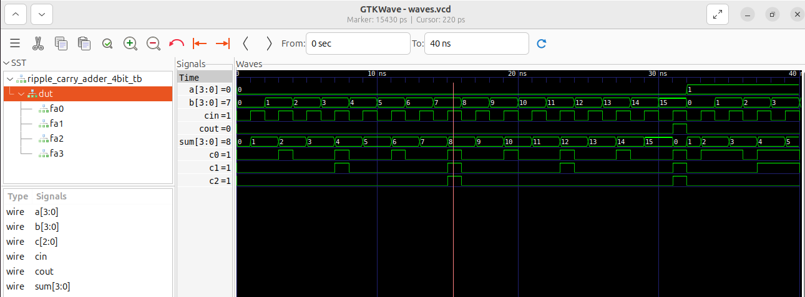

# 4-bit ripple-carry adder
This is my second Verilog project. After generating an adder from C using Bambu HLS, I wanted to build one myself from the ground up, using only basic logic gates and full adders. Then I compared my version with what Bambu generated.

4-bit adder in Verilog made from four 1-bit full adders. I wrote it by hand and then ran the equivalent C function through Bambu HLS to see how different the generated version is.

## Files

```
rtl/full_adder.v                  1-bit full adder
rtl/ripple_carry_adder_4bit.v     4 full adders chained together
rtl/add4.v                        Bambu output, only here for comparison
tb/ripple_carry_adder_4bit_tb.v   testbench
src/add4.c                        C source given to Bambu
```

## Design

Each full adder does:

```
sum  = a ^ b ^ cin
cout = (a & b) | (b & cin) | (a & cin)
```

The carry out of each stage feeds the carry in of the next one, so the carry has to travel from bit 0 all the way to bit 3 before `cout` is valid. That is the whole point of a ripple-carry adder and also its weakness: the critical path grows linearly with the width. Fine for 4 bits, bad for 32 or 64, which is why carry-lookahead exists.

The module is purely combinational. No clock, no reset.

## Running the simulation

Needs Icarus Verilog.

```bash
iverilog -o sim rtl/full_adder.v rtl/ripple_carry_adder_4bit.v tb/ripple_carry_adder_4bit_tb.v
vvp sim
```

Expected output:

```
PASS: all 512 cases correct
```

The testbench is exhaustive: 16 x 16 x 2 = 512 combinations of `a`, `b` and `cin`. Each result is compared against Verilog's own `+` using `!==`, so an `x` or `z` on the output counts as a failure instead of slipping through. It also dumps `waves.vcd`:

```bash
gtkwave waves.vcd &
```

Note that GTKWave opens empty. You have to expand the testbench in the SST panel and append the signals yourself.

## Comparison with Bambu

`src/add4.c` is just `(a + b) & 0xF`. Bambu turns it into a module with `clock`, `reset`, `start_port`, `done_port` and a `return_port`, so it is a small FSM with a start/done handshake. My version has none of that and the output settles right after the inputs change.

Bambu also does not build the adder from full adders. It infers a single `+`, and the actual adder structure is left to whatever synthesis tool comes after. For something this small the hand-written version is simpler and smaller. HLS makes more sense when the algorithm is big enough that writing the datapath and control by hand would take a long time.

## Not done yet

- no synthesis run, so no real area or timing numbers
- haven't tried it on an FPGA
- only unsigned 4-bit, no overflow flag

## Tools

Icarus Verilog, GTKWave, Bambu 0.9.7, Ubuntu


## Static timing analysis

I synthesized the adder with Yosys against the sky130_fd_sc_hd library (tt, 25 C, 1.8 V) and timed it with OpenSTA. The design has no clock, so the SDC uses a virtual clock and measures the input-to-output delay. Constraints are in `sta/constraints.sdc`.

The library file is not in the repo (it is several MB). Download it first:

```bash
wget -O sta/sky130_tt.lib https://raw.githubusercontent.com/efabless/skywater-pdk-libs-sky130_fd_sc_hd/master/timing/sky130_fd_sc_hd__tt_025C_1v80.lib
```

Then run:

```bash
yosys -s sta/synth.ys
sta -no_init -exit sta/run_sta.tcl
```

Results (full report in `docs/sta_report.txt`):

- Critical path: `cin` to `cout` (four cells: maj3, a21boi, o21ai, maj3)
- Arrival time: 1.197 ns
- Slack at a 5 ns target: +3.803 ns (met)
- Cell area: 116.361600

This is a pre-layout estimate with no wire parasitics.
The synthesized netlist does not keep the four-full-adder structure from the RTL. abc restructured the logic, and the carry path ended up as four cells, so the timing above is for the optimized gate-level design rather than a literal chain of four full adders. The critical path still goes from `cin` to `cout`, which is the carry chain.
